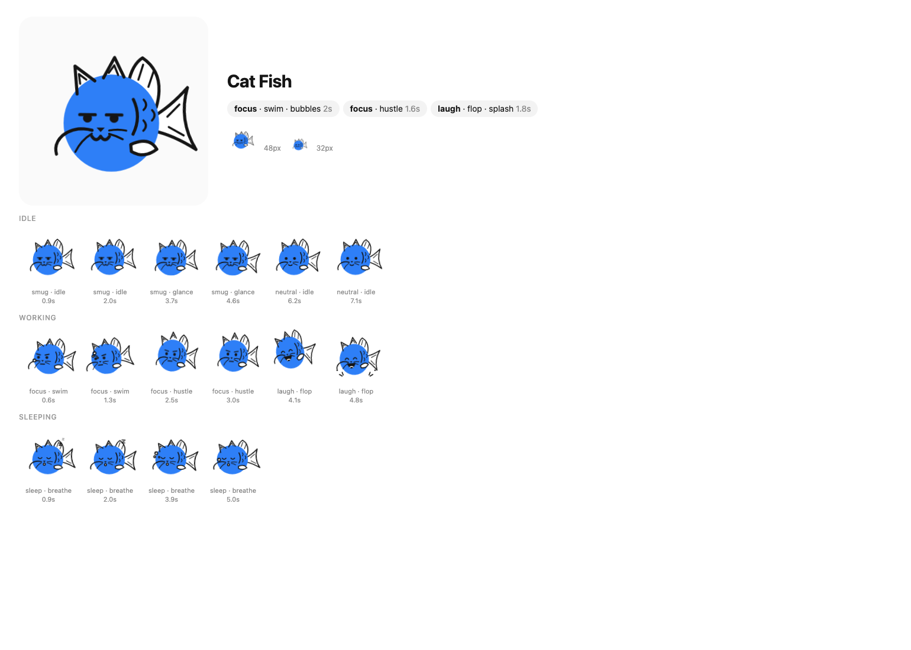
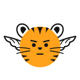

<h1 align="center">Bots</h1>

<p align="center"><b>A Claude skill that turns a few words into a unique, animated avatar character.</b><br>Hand-drawn style, its own personality, and a self-contained SVG you can drop in anywhere.</p>

<p align="center">
  <a href="https://code.claude.com/docs/en/skills"></a>
  <a href="https://agentskills.io"></a>
  <a href="LICENSE"></a>
  <a href="#requirements"></a>
  <a href="#requirements"></a>
</p>

<p align="center">
  
  
  
</p>

<p align="center"><sub>These are the actual SVG files. The animation is CSS inside them, so they play right here.</sub></p>

---

Ask for `/bots cat fish` and the skill designs a character, not a template with a hat swapped on. It decides what makes a cat fish readable at 48px: cat ears, fins, a forked tail, barbels. It draws those parts in one consistent style: a flat colour disc with off-register ink line art. Then it writes the character's personality as a little looping performance. The cat fish is a smug "top predator" who swims with bubbles, gets spooked by its own bubbles, grumbles, and flops like a fish out of water when it laughs.

Every character gets:

- **Expressions that swap instantly**, like hand-drawn frames: laughing, skeptical, sad, surprised, angry and more.
- **Squash and stretch with real easing**: a wind-up before a jump, overshoot on landing, appendages that lag and settle.
- **Body parts that react to its mood.** Wings flap faster when it laughs and sag when it's sad; a tail wags harder when it's happy.
- **A signature move and a signature effect** of its own (a flap-and-hover, a fish flop, steam, feathers, bubbles).
- **Three states**: idle, working and sleeping.

## Quick start

```sh
npx skills add frontendsupply/bots -g
```

Then, in Claude Code:

```text
/bots cat fish
```

```text
/bots a sleepy cloud for our support bot
```

No API keys and nothing to `npm install`. The kit uses only Node's built-in modules.

## What you get

```text
avatars/cat-fish/
├── cat-fish.json           the character: drawing, moves, effects, states
├── cat-fish.svg            idle, animated
├── cat-fish-working.svg
├── cat-fish-sleeping.svg
├── preview.html            the live character, plus paused frames inside every beat of every state
└── frames.png              a screenshot of the frames (if Chrome/Chromium/Brave/Edge is installed)
```

Use it like any image:

```html

```

The SVGs are self-contained (no scripts, fonts or external files), scale to any size, and hold still for people who've turned on reduced motion.

## How it works

1. **The skill designs** the character in a small JSON file. It holds drawing layers at five depths (back, front, face, over, top), custom moves, effects and expressions, and three states (idle, working, sleeping), each a list of beats pairing an expression with a move and an effect. Idle waits calmly, working is a short busy loop.
2. **The kit renders it.** `kit/avatar.mjs` turns the file into CSS keyframes inside an SVG: one timeline for the beats, always-on loops for things like wings, and a constant subtle line boil so nothing is ever fully still.
3. **The build checks it.** `kit/build.mjs` validates the file with exact, fixable messages (`layers[2].react.laugh.keys[1]: unknown ease "bounce"`), writes the SVGs, and screenshots the character at 48px and 32px plus two paused frames inside every beat.
4. **The agent looks at its own work.** It opens `frames.png`, checks that the character reads as the idea and that nothing clips or floats, then fixes and builds once more.

<p align="center"></p>

<p align="center"><sub>What the agent sees after a build: <code>frames.png</code> for the cat fish.</sub></p>

## Examples

| | idle | working | sleeping |
|---|---|---|---|
| **Cat Fish** · smug, easily spooked |  |  |  |
| **Flying Tiger** · proud, scared of heights |  |  |  |
| **Roast Turkey** · hot, salty, wobbly |  |  |  |

The cat fish and flying tiger were each made by a fresh agent from just `/bots cat fish` and `/bots flying tiger`, in one pass.

## Install

The quick way is `npx skills add frontendsupply/bots -g`. The CLI asks which agents to set up.

To install by hand for Claude Code, clone the repo into your skills folder:

```sh
git clone https://github.com/frontendsupply/bots ~/.claude/skills/bots
```

## Requirements

- Node.js 18 or later.
- Optional: Chrome, Chromium, Brave or Edge, for `frames.png`. Set `CHROME_PATH` to choose one. Without a browser, the skill still builds and validates; it just can't look at its frames.

## Development

```sh
node --test tests/*.test.mjs                                # engine, validator and build tests
node kit/build.mjs examples/cat-fish/cat-fish.json --shot   # rebuild an example
```

[SKILL.md](SKILL.md) is the skill itself: the house style, the file format, the built-in vocabulary and the acting rules. If you change the kit, keep it in sync. See [CONTRIBUTING.md](CONTRIBUTING.md).

## License

[MIT](LICENSE)
